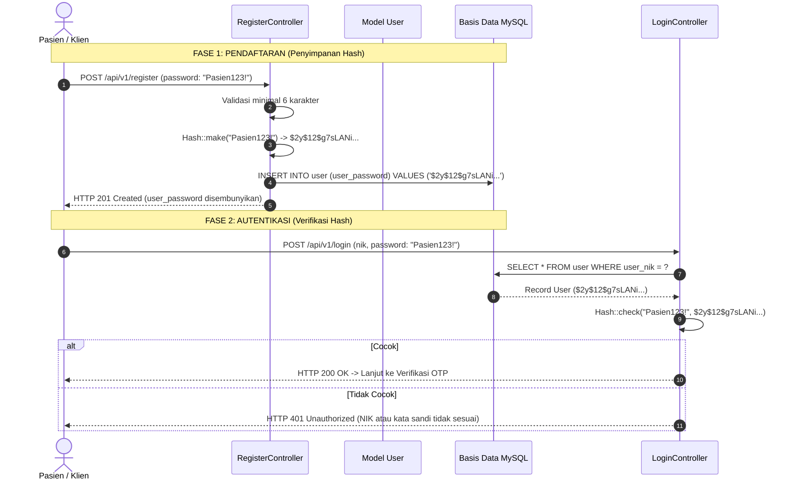

# Panduan Teknis Keamanan Kata Sandi (Password Security) — KLINIKU

Dokumen ini disusun khusus bagi tim pengembang backend, arsitek sistem, dan auditor keamanan informasi untuk memahami arsitektur perlindungan kredensial kata sandi pada platform **KLINIKU**.

---

## 1. Ringkasan Eksekutif & Latar Belakang

Kata sandi pengguna merupakan benteng otentikasi awal yang paling rentan terhadap serangan siber. Berdasarkan standar keamanan industri (**OWASP Top 10: Identification and Authentication Failures** serta **NIST SP 800-63B**), penyimpanan kata sandi dilarang keras menggunakan format *plaintext* maupun enkripsi dua arah (*reversible encryption*).

Sistem backend KLINIKU mengadopsi prinsip pertahanan berlapis:
1. **One-Way Hashing**: Menggunakan fungsi *cryptographic hash function* satu arah berbasis **Bcrypt**.
2. **Anti-Plaintext Policy**: Kata sandi di-hash sebelum transaksi database dijalankan, sehingga administrator atau siapa pun yang memiliki akses ke database tidak dapat membaca kata sandi asli.
3. **Anti-Leakage Serialization**: Kata sandi disembunyikan secara otomatis dari serialisasi array dan respons JSON HTTP melalui atribut proteksi model Eloquent.
4. **Timing-Attack Resistance**: Verifikasi login dilakukan menggunakan algoritma perbandingan *constant-time* untuk mencegah penyerang mengukur latensi respons.

---

## 2. Arsitektur & Cara Kerja Algoritma Bcrypt

Bcrypt dirancang oleh Niels Provos dan David Mazières berbasis algoritma *cipher* Blowfish. Keunggulan Bcrypt terletak pada sifat *adaptive cost factor*:

```
Plaintext Password + Random Salt (Generated automatically) 
               │
               ▼
   [ Key Derivation Function (EksBlowfish) ] <─── Work Factor / Rounds: 12
               │
               ▼
    Hashed Output: $2y$12$[22_char_salt][31_char_hash]  (Panjang total: 60 Karakter)
```

### Karakteristik String Hash Bcrypt di KLINIKU:
Contoh string yang tersimpan di kolom `user_password`:
```text
$2y$12$g7sLANiTkkZw0v.qbwZbvumkIMgzx4fCyheTOARbpJ/Tzvdob0DCy
│  │  │                     │
│  │  │                     └── 31 Karakter Ciphertext Hashed Key
│  │  └──────────────────────── 22 Karakter Random Salt Otomatis
│  └─────────────────────────── Cost Factor / Work Factor = 12 (4.096 iterasi)
└────────────────────────────── Identifier Versi Bcrypt Modern ($2y$)
```

### Mengapa Bcrypt Sangat Aman?
1. **Built-in Salting**: Setiap kata sandi yang di-hash menghasilkan *salt* acak 128-bit unik. Dua pasien dengan kata sandi yang persis sama ("Pasien123!") akan menghasilkan nilai hash yang **100% berbeda** di database. Hal ini membuat serangan *Precomputed Rainbow Table* menjadi mustahil.
2. **Work Factor / Iterasi Terkendali**: KLINIKU menetapkan `rounds = 12` (2¹² = 4.096 putaran kalkulasi). Membutuhkan komputasi intensif (~250-300 ms per hash) pada CPU server, membuat serangan *offline brute force* atau *dictionary attack* menggunakan GPU ribuan kali lebih lambat dan tidak realistis bagi penyerang.

---

## 3. Alur Kerja Sistem (Sequence Diagram)



---

## 4. Berkas dan Potongan Kode Terkait

### 4.1 Registrasi Pasien — [RegisterController.php](file:///root/Melissa/kliniku/backend/app/Http/Controllers/Api/RegisterController.php)
Pada baris 73, kata sandi di-hash secara eksplisit sebelum disimpan ke database:
```php
// File: backend/app/Http/Controllers/Api/RegisterController.php (Baris 66-76)

$user = User::create([
    'user_id' => $userId,
    'user_role' => 'pasien',
    'user_nama' => trim($validated['nama']),
    'user_nik' => $validated['nik'],
    'user_nowa' => $nowa,
    'user_email' => strtolower(trim($validated['email'])),
    'user_password' => Hash::make($validated['password']), // <-- Bcrypt Hashing
    'user_status' => 'aktif',
]);
```

### 4.2 Verifikasi Login — [LoginController.php](file:///root/Melissa/kliniku/backend/app/Http/Controllers/Api/LoginController.php)
Pada baris 58, kata sandi plaintext diverifikasi terhadap hash database menggunakan metode *constant-time comparison*:
```php
// File: backend/app/Http/Controllers/Api/LoginController.php (Baris 53-63)

/** @var User|null $user */
$user = User::with(['pasien.poli', 'dokter.poli', 'staf'])
    ->where('user_nik', $validated['nik'])
    ->first();

if (!$user || !Hash::check($validated['password'], $user->user_password)) {
    return response()->json([
        'success' => false,
        'message' => 'Login gagal. NIK atau kata sandi yang Anda masukkan tidak sesuai.',
    ], 401);
}
```

### 4.3 Proteksi Anti-Kebocoran Model — [User.php](file:///root/Melissa/kliniku/backend/app/Models/User.php)
Pada baris 32-34, atribut `$hidden` memastikan atribut `user_password` tidak pernah dikembalikan ke luar server:
```php
// File: backend/app/Models/User.php (Baris 32-34)

protected $hidden = [
    'user_password',
];
```

### 4.4 Konfigurasi Enkripsi — [config/hashing.php](file:///root/Melissa/kliniku/backend/config/hashing.php) & [.env](file:///root/Melissa/kliniku/backend/.env)
```dotenv
# File: backend/.env
BCRYPT_ROUNDS=12
```
Konfigurasi `rounds=12` menjamin keseimbangan optimal antara beban server dan ketahanan terhadap serangan komputasi tinggi.

---

## 5. Rute API yang Menggunakan Fitur Ini

### 5.1 Endpoint Pendaftaran Akun Pasien
- **URL**: `/api/v1/register`
- **Method**: `POST`
- **Header**: `Content-Type: application/json`
- **Payload Request**:
  ```json
  {
    "nik": "3372091508980099",
    "nama": "Budi Santoso",
    "email": "budi@kliniku.id",
    "nowa": "081299887766",
    "password": "MySecretPassword123!",
    "alamat": "Jl. Slamet Riyadi No. 10, Surakarta"
  }
  ```
- **Respons Sukses (`201 Created`)**:
  ```json
  {
    "success": true,
    "message": "Pendaftaran akun pasien berhasil! Nomor Rekam Medis (RM) telah dibuat. Silakan melanjutkan ke halaman login.",
    "data": {
      "user_id": "USR-PAS-0105",
      "user_nama": "Budi Santoso",
      "user_nik": "3372091508980099",
      "user_email": "budi@kliniku.id",
      "pasien_norm": "RM-2026-0105"
      // user_password TIDAK PERNAH ADA di sini
    }
  }
  ```

---

## 6. Pengujian Otomatis (Automated Testing)

Pengujian fitur keamanan kata sandi terdaftar pada [SecurityFeaturesTest.php](file:///root/Melissa/kliniku/backend/tests/Feature/SecurityFeaturesTest.php).

### Skenario Uji 1: Memverifikasi Kata Sandi Di-hash dengan Bcrypt
```php
public function test_registered_user_password_is_hashed_with_bcrypt_and_never_plaintext(): void
{
    $plainPassword = 'MySecretPassword123!';
    $nik = '3372091508980099';

    $response = $this->postJson('/api/v1/register', [
        'nik' => $nik,
        'nama' => 'Bcrypt Security Verification',
        'email' => 'bcrypt.test@kliniku.id',
        'nowa' => '081299887766',
        'password' => $plainPassword,
        'alamat' => 'Jl. Keamanan Siber No. 1, Surakarta',
    ]);

    $response->assertStatus(201);

    $user = User::where('user_nik', $nik)->first();
    $this->assertNotNull($user);

    // 1. Password must NEVER equal plaintext
    $this->assertNotEquals($plainPassword, $user->user_password);

    // 2. Password must start with $2y$ (Bcrypt hash prefix)
    $this->assertStringStartsWith('$2y$', $user->user_password);

    // 3. Password hash must verify with Bcrypt Hash::check
    $this->assertTrue(Hash::check($plainPassword, $user->user_password));

    // 4. Verification fails on wrong password
    $this->assertFalse(Hash::check('WrongPassword123!', $user->user_password));
}
```

### Skenario Uji 2: Memverifikasi Tidak Ada Kebocoran Kata Sandi ke JSON/Array
```php
public function test_user_password_is_hidden_from_array_and_json_serialization(): void
{
    $user = User::where('user_role', 'pasien')->first();
    $this->assertNotNull($user);

    // Serialization to Array must not expose user_password
    $userArray = $user->toArray();
    $this->assertArrayNotHasKey('user_password', $userArray);

    // Serialization to JSON must not expose user_password
    $userJson = json_encode($user);
    $this->assertStringNotContainsString('user_password', $userJson);
}
```

### Cara Menjalankan Tes:
```bash
docker compose exec app php artisan test --filter SecurityFeaturesTest
```

---

## 7. Rekomendasi untuk Pengembang Frontend

1. **Gunakan Input Type yang Tepat**: Selalu gunakan `<input type="password">` pada antarmuka login dan registrasi agar karakter tidak terbaca di layar.
2. **Koneksi Wajib HTTPS / TLS**: Pastikan komunikasi web production menggunakan protokol HTTPS (port 443) agar kata sandi terenkripsi saat transit dari browser ke web server.
3. **Penyimpanan di Klien**: Frontend **dilarang menyimpan kata sandi** pengguna di `localStorage`, `sessionStorage`, atau *cookies*. Klien hanya boleh menyimpan token JWT sesi yang diterbitkan setelah seluruh tahap verifikasi login dan OTP selesai.
