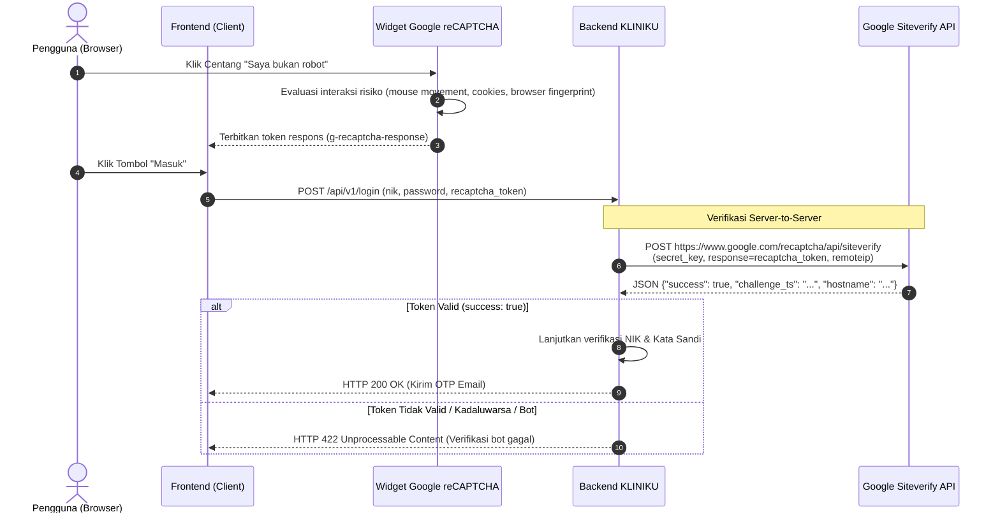

# Panduan Teknis Verifikasi Bot Google reCAPTCHA (CAPTCHA) — KLINIKU

Dokumen ini disusun khusus bagi tim pengembang frontend, backend, dan tim operasional sistem untuk memahami implementasi perlindungan bot otomatis menggunakan **Google reCAPTCHA v2** pada sistem autentikasi **KLINIKU**.

---

## 1. Ringkasan Eksekutif & Latar Belakang

Formulir login yang dapat diakses secara publik menjadi sasaran utama serangan otomasi siber, seperti:
- **Credential Stuffing (OWASP OAT-008)**: Penyerang menggunakan daftar kombinasi akun hasil kebocoran data (*data breach*) dari situs lain untuk mencoba masuk secara massal ke KLINIKU.
- **Brute Force & Dictionary Attacks (OWASP OAT-007)**: Bot menebak ribuan variasi kata sandi dalam hitungan detik.
- **Application Denial of Service (DoS)**: Pengiriman request login masif yang membebani komputasi CPU akibat kalkulasi hash Bcrypt.

Untuk menanggulangi ancaman tersebut, KLINIKU menerapkan **Google reCAPTCHA v2 ("Saya bukan robot" / Checkbox Challenge)** sebagai gerbang validasi awal sebelum pemeriksaan kredensial di database diproses.

---

## 2. Arsitektur & Cara Kerja Google reCAPTCHA v2

Verifikasi reCAPTCHA melibatkan interaksi 3 pihak: **Browser Pengguna (Frontend)**, **Backend KLINIKU**, dan **Server Google Siteverify API**.



### Prinsip Keamanan Validasi Token:
1. **Server-Side Verification**: Token reCAPTCHA **wajib divalidasi oleh backend**. Validasi tidak boleh hanya dipercayakan pada antarmuka frontend karena penyerang dapat memanipulasi kode JavaScript.
2. **Single-Use Token**: Setiap token respons dari Google hanya dapat digunakan **satu kali**. Jika token dicoba untuk request login kedua, Google Siteverify API akan mengembalikan `false` (error code: `timeout-or-duplicate`).
3. **Masa Berlaku Singkat**: Token hanya berlaku selama 2 menit sejak diterbitkan oleh widget Google.

---

## 3. Berkas dan Potongan Kode Terkait

### 3.1 Service Validasi — [RecaptchaService.php](file:///root/Melissa/kliniku/backend/app/Services/RecaptchaService.php)
Service khusus yang bertanggung jawab melakukan komunikasi HTTP POST ke Google API:
```php
// File: backend/app/Services/RecaptchaService.php (Baris 20-48)

public function verify(?string $token, ?string $ip = null): bool
{
    if (empty($token)) {
        return false;
    }

    // Bypass terkendali khusus lingkungan local / testing
    if (app()->environment('testing', 'local') && in_array($token, ['test-valid-token', 'passthrough-token', 'valid-recaptcha-token'])) {
        return true;
    }

    try {
        $response = Http::asForm()->timeout(5)->post($this->verifyUrl, [
            'secret' => $this->secretKey,
            'response' => $token,
            'remoteip' => $ip,
        ]);

        if (!$response->successful()) {
            return false;
        }

        $data = $response->json();
        return (bool) ($data['success'] ?? false);
    } catch (\Throwable $e) {
        Log::error('reCAPTCHA Verification Error: ' . $e->getMessage());
        return false;
    }
}
```

### 3.2 Form Request Validation — [LoginRequest.php](file:///root/Melissa/kliniku/backend/app/Http/Requests/LoginRequest.php)
Memastikan parameter `recaptcha_token` wajib ada sebelum controller dieksekusi:
```php
// File: backend/app/Http/Requests/LoginRequest.php (Baris 27-32)

return [
    'nik' => ['required', 'string', 'regex:/^[0-9]{16}$/'],
    'password' => ['required', 'string'],
    'recaptcha_token' => ['required', 'string'],
];
```

### 3.3 Penegakan di Controller — [LoginController.php](file:///root/Melissa/kliniku/backend/app/Http/Controllers/Api/LoginController.php)
Controller memeriksa hasil verifikasi reCAPTCHA pada langkah paling pertama, **sebelum** query pencarian database atau kalkulasi hash Bcrypt dilakukan:
```php
// File: backend/app/Http/Controllers/Api/LoginController.php (Baris 40-50)

// 1. Verifikasi Google reCAPTCHA v2 (Wajib Lolos Sebelum Database Dihubungi)
$isCaptchaValid = $this->recaptchaService->verify($validated['recaptcha_token'], $request->ip());

if (!$isCaptchaValid) {
    return response()->json([
        'success' => false,
        'message' => 'Verifikasi reCAPTCHA gagal. Pastikan Anda telah mencentang widget "Saya bukan robot" dengan benar.',
        'errors' => [
            'recaptcha_token' => ['Verifikasi bot reCAPTCHA tidak valid atau telah kedaluwarsa.'],
        ],
    ], 422);
}
```

### 3.4 Konfigurasi Kredensial — [config/services.php](file:///root/Melissa/kliniku/backend/config/services.php) & [.env](file:///root/Melissa/kliniku/backend/.env)
```dotenv
# File: backend/.env
RECAPTCHA_SITE_KEY=6LfEiisuAAAAAM1dgo05Kv4IqPwYUF5NTWbDUN9V
RECAPTCHA_SECRET_KEY=6LfEiisuAAAAAEPuGqfaxFfGOtUGHNdZq0djWVkd
```
- `RECAPTCHA_SITE_KEY`: Kunci publik yang ditempel pada script frontend.
- `RECAPTCHA_SECRET_KEY`: Kunci rahasia server-side yang **tidak boleh dibocorkan ke klien**.

---

## 4. Rute API dan Parameter Request/Response

### Endpoint Login Pasien
- **URL**: `/api/v1/login` *(Alias: `/api/login`)*
- **Method**: `POST`
- **Header**: `Content-Type: application/json`

#### Contoh Payload Request:
```json
{
  "nik": "3372020912254658",
  "password": "Pasien123!",
  "recaptcha_token": "03AFcWeA6d8... (token respons dari widget)"
}
```

#### Skenario 1: Token Valid (`200 OK`)
```json
{
  "success": true,
  "message": "Kredensial dan reCAPTCHA valid. Kode OTP 6 digit telah dikirimkan ke email l***i@student.uns.ac.id.",
  "step": "otp_verification",
  "data": {
    "otp_session_id": "otp_9c118683...",
    "masked_email": "l***i@student.uns.ac.id",
    "expires_in": 300
  }
}
```

#### Skenario 2: Token reCAPTCHA Ditolak / Tidak Valid (`422 Unprocessable Content`)
```json
{
  "success": false,
  "message": "Verifikasi reCAPTCHA gagal. Pastikan Anda telah mencentang widget \"Saya bukan robot\" dengan benar.",
  "errors": {
    "recaptcha_token": [
      "Verifikasi bot reCAPTCHA tidak valid atau telah kedaluwarsa."
    ]
  }
}
```

#### Skenario 3: Parameter `recaptcha_token` Dikosongkan (`422 Unprocessable Content`)
```json
{
  "message": "Parameter recaptcha_token (atau token bot) wajib disertakan.",
  "errors": {
    "recaptcha_token": [
      "Parameter recaptcha_token (atau token bot) wajib disertakan."
    ]
  }
}
```

---

## 5. Pengujian Otomatis (Automated Testing)

Pengujian fitur CAPTCHA terdaftar pada [SecurityFeaturesTest.php](file:///root/Melissa/kliniku/backend/tests/Feature/SecurityFeaturesTest.php).

### Skenario Uji 1: Login Berhasil dengan Token Valid
```php
public function test_login_succeeds_with_valid_captcha_token(): void
{
    Mail::fake();

    $response = $this->postJson('/api/v1/login', [
        'nik' => '3372020912254658',
        'password' => 'Pasien123!',
        'recaptcha_token' => 'test-valid-token',
    ]);

    $response->assertStatus(200);
    $response->assertJson([
        'success' => true,
        'step' => 'otp_verification',
    ]);
}
```

### Skenario Uji 2: Login Gagal saat Token Ditolak oleh Google API
```php
public function test_login_fails_with_invalid_captcha_token(): void
{
    // Mock RecaptchaService agar mengembalikan false
    $this->mock(RecaptchaService::class, function ($mock) {
        $mock->shouldReceive('verify')->andReturn(false);
    });

    $response = $this->postJson('/api/v1/login', [
        'nik' => '3372020912254658',
        'password' => 'Pasien123!',
        'recaptcha_token' => 'invalid-bot-challenge-token',
    ]);

    $response->assertStatus(422);
    $response->assertJson([
        'success' => false,
        'errors' => [
            'recaptcha_token' => ['Verifikasi bot reCAPTCHA tidak valid atau telah kedaluwarsa.'],
        ],
    ]);
}
```

### Skenario Uji 3: Login Ditolak Jika Token Tidak Disertakan
```php
public function test_login_fails_when_captcha_token_is_missing(): void
{
    $response = $this->postJson('/api/v1/login', [
        'nik' => '3372020912254658',
        'password' => 'Pasien123!',
    ]);

    $response->assertStatus(422);
    $response->assertJsonValidationErrors(['recaptcha_token']);
}
```

---

## 6. Panduan untuk Pengembang Frontend (Web & Mobile)

Implementasi acuan dapat dilihat langsung pada berkas GUI Test Client [frontend/index.html](file:///root/Melissa/kliniku/frontend/index.html).

### 1. Muat Script Google reCAPTCHA
Tambahkan baris berikut di dalam tag `<head>`:
```html
<script src="https://www.google.com/recaptcha/api.js" async defer></script>
```

### 2. Render Widget pada Form Login
Letakkan elemen `div` widget tepat di atas tombol submit:
```html
<div class="g-recaptcha" 
     data-sitekey="6LfEiisuAAAAAM1dgo05Kv4IqPwYUF5NTWbDUN9V" 
     data-callback="onCaptchaResolved">
</div>
```

### 3. Tangani Callback JavaScript
```javascript
let currentCaptchaToken = '';

function onCaptchaResolved(token) {
    currentCaptchaToken = token;
}

async function handleLoginSubmit(event) {
    event.preventDefault();
    
    if (!currentCaptchaToken) {
        alert('Silakan centang "Saya bukan robot" terlebih dahulu.');
        return;
    }

    const payload = {
        nik: document.getElementById('login-nik').value,
        password: document.getElementById('login-password').value,
        recaptcha_token: currentCaptchaToken
    };

    const res = await fetch('/api/v1/login', {
        method: 'POST',
        headers: { 'Content-Type': 'application/json', 'Accept': 'application/json' },
        body: JSON.stringify(payload)
    });
    
    const data = await res.json();
    if (!res.ok) {
        // Reset widget jika login gagal agar pengguna dapat mencoba kembali
        grecaptcha.reset();
        currentCaptchaToken = '';
        alert(data.message || 'Login gagal.');
    }
}
```
