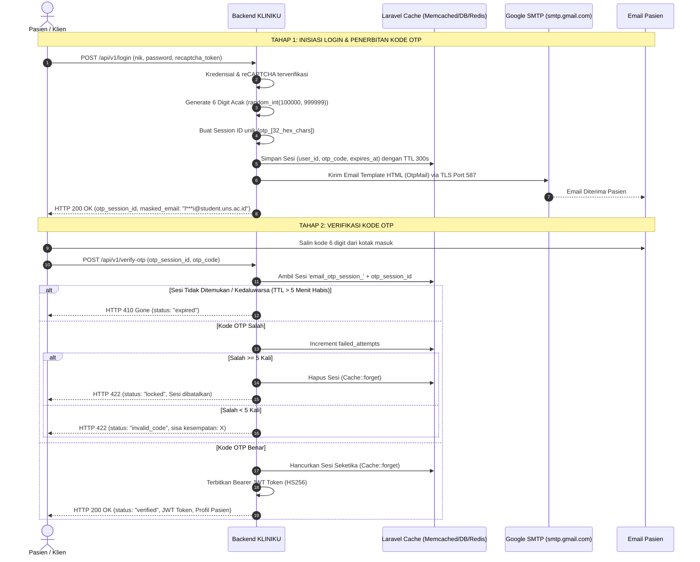

# Panduan Teknis One-Time Password (OTP) 2FA — KLINIKU

Dokumen ini disusun khusus bagi tim pengembang autentikasi, backend, dan tim keamanan informasi untuk memahami arsitektur dan siklus hidup verifikasi dua langkah (**Two-Factor Authentication / 2FA**) berbasis **Email OTP** pada sistem **KLINIKU**.

---

## 1. Ringkasan Eksekutif & Latar Belakang

Otentikasi satu faktor (*single-factor authentication*) yang hanya mengandalkan kombinasi NIK dan kata sandi memiliki risiko tinggi jika kata sandi pasien terkompromi (misalnya akibat *phishing*, pencurian perangkat, atau *keylogger*). 

Sesuai dengan standar **NIST SP 800-63B Authentication Assurance Level 2 (AAL2)**, platform KLINIKU mewajibkan faktor otentikasi kedua berupa kepemilikan akses (*Something You Have / Out-of-Band Possession Factor*). Token sesi berbasis JSON Web Token (JWT) **hanya akan diterbitkan setelah pengguna berhasil membuktikan kepemilikan email terdaftarnya melalui kode One-Time Password (OTP)**.

### Tiga Pilar Keamanan OTP di KLINIKU:
1. **Cryptographically Secure Randomness**: Kode OTP dibuat menggunakan generator acak aman (*CSPRNG*).
2. **Batas Waktu Berlaku Ketat (Time-Bound)**: Kode hanya berlaku selama **300 detik (5 menit)** sejak diterbitkan.
3. **Sekali Pakai Mutlak (Single-Use Guarantee)**: Kode dan sesi langsung dimusnahkan seketika setelah verifikasi berhasil, mencegah segala bentuk serangan pengulangan (*replay attack*).
4. **Proteksi Anti-Tebak (Brute-Force Lockout)**: Sesi dibatalkan secara otomatis jika pengguna salah memasukkan kode sebanyak 5 kali.

---

## 2. Arsitektur & Siklus Hidup Sesi OTP



---

## 3. Berkas dan Potongan Kode Terkait

### 3.1 Penerbitan OTP saat Login — [LoginController.php](file:///root/Melissa/kliniku/backend/app/Http/Controllers/Api/LoginController.php)
Pada baris 81-118, kode OTP 6 digit dibuat menggunakan CSPRNG dan disimpan di Cache:
```php
// File: backend/app/Http/Controllers/Api/LoginController.php (Baris 81-93)

// 5. Generate 6-Digit OTP Code & Session ID
$otpCode = sprintf('%06d', random_int(100000, 999999));
$sessionId = 'otp_' . bin2hex(random_bytes(16));
$expiresIn = 300; // 5 menit

// Simpan sesi di Cache dengan TTL 300 detik (+30 detik grace period)
Cache::put('email_otp_session_' . $sessionId, [
    'user_id' => $user->user_id,
    'user_nik' => $user->user_nik,
    'email' => $user->user_email,
    'otp_code' => $otpCode,
    'expires_at' => now()->addSeconds($expiresIn)->timestamp,
    'failed_attempts' => 0,
], now()->addSeconds($expiresIn + 30));

// 6. Kirim Email via SMTP
Mail::to($user->user_email)->send(new OtpMail($user->user_nama, $otpCode, $expiresIn));
```

### 3.2 Verifikasi, Pembatasan Percobaan, & Pemusnahan Sesi — [LoginController.php](file:///root/Melissa/kliniku/backend/app/Http/Controllers/Api/LoginController.php)
Pada baris 179-211, kode diperiksa secara ketat dan langsung dihancurkan:
```php
// File: backend/app/Http/Controllers/Api/LoginController.php (Baris 179-211)

$session = Cache::get('email_otp_session_' . $sessionId);

if (!$session) {
    return response()->json([
        'success' => false,
        'status' => 'expired',
        'message' => 'Sesi verifikasi OTP tidak ditemukan atau telah kedaluwarsa. Silakan lakukan login ulang.',
    ], 410);
}

// Validasi kecocokan kode OTP & penanganan percobaan salah
if ($inputCode !== (string) $session['otp_code']) {
    $failedAttempts = ($session['failed_attempts'] ?? 0) + 1;
    
    // Kunci dan musnahkan sesi jika salah >= 5 kali
    if ($failedAttempts >= 5) {
        Cache::forget('email_otp_session_' . $sessionId);
        return response()->json([
            'success' => false,
            'status' => 'locked',
            'message' => 'Terlalu banyak percobaan kode OTP yang salah. Sesi telah dibatalkan demi keamanan. Silakan login ulang.',
        ], 422);
    }

    $session['failed_attempts'] = $failedAttempts;
    $remainingSeconds = max(1, ($session['expires_at'] ?? now()->timestamp) - now()->timestamp);
    Cache::put('email_otp_session_' . $sessionId, $session, $remainingSeconds);

    $attemptsLeft = 5 - $failedAttempts;
    return response()->json([
        'success' => false,
        'status' => 'invalid_code',
        'message' => "Kode OTP yang Anda masukkan salah. Sisa kesempatan: {$attemptsLeft} kali.",
        'attempts_left' => $attemptsLeft,
    ], 422);
}

// JIKA BENAR: Terbitkan JWT dan HANCURKAN SESI (Anti-Replay Attack)
$token = $this->jwtService->generateToken($user);
Cache::forget('email_otp_session_' . $sessionId); // <-- Sesi dimusnahkan!
```

### 3.3 Mailable & Branded Template Email — [OtpMail.php](file:///root/Melissa/kliniku/backend/app/Mail/OtpMail.php) & [otp.blade.php](file:///root/Melissa/kliniku/backend/resources/views/emails/otp.blade.php)
Email dikirim dalam format HTML responsif yang elegan:
- Menampilkan nama pasien (`$userName`).
- Menampilkan kode 6 digit dalam *callout box* berhuruf besar dengan spasi renggang (`letter-spacing: 6px;`).
- Menampilkan instruksi keamanan: *"Jangan pernah membagikan kode ini kepada siapa pun, termasuk staf atau petugas medis KLINIKU."*

---

## 4. Katalog Rute API Terkait

### 4.1 Kirim Ulang OTP (`POST /api/v1/resend-otp`)
Jika email belum masuk atau sesi lama habis, klien dapat meminta kode baru:
- **Payload Request**:
  ```json
  {
    "otp_session_id": "otp_9c118683..."
  }
  ```
- **Mekanisme**: Backend memvalidasi sesi lama, menghapus sesi lama, menerbitkan kode baru dan session ID baru, lalu mengirimkannya via email.

---

## 5. Pengujian Otomatis (Automated Testing)

Pengujian fitur OTP terdaftar pada [SecurityFeaturesTest.php](file:///root/Melissa/kliniku/backend/tests/Feature/SecurityFeaturesTest.php).

### Skenario Uji 1: Memverifikasi OTP Hanya Dapat Digunakan Satu Kali (Single-Use)
```php
public function test_otp_is_single_use_and_cannot_be_reused_after_successful_verification(): void
{
    $sessionId = 'test_single_use_session_' . uniqid();
    $otpCode = '654321';
    $user = User::where('user_role', 'pasien')->first();

    Cache::put('email_otp_session_' . $sessionId, [
        'user_id' => $user->user_id,
        'user_nik' => $user->user_nik,
        'email' => $user->user_email,
        'otp_code' => $otpCode,
        'expires_at' => now()->addSeconds(300)->timestamp,
    ], 300);

    // Percobaan ke-1: SUKSES (200 OK)
    $firstAttempt = $this->postJson('/api/v1/verify-otp', [
        'otp_session_id' => $sessionId,
        'otp_code' => $otpCode,
    ]);
    $firstAttempt->assertStatus(200);

    // Percobaan ke-2 dengan kode dan sesi yang sama: WAJIB DITOLAK (410 Gone)
    $secondAttempt = $this->postJson('/api/v1/verify-otp', [
        'otp_session_id' => $sessionId,
        'otp_code' => $otpCode,
    ]);
    $secondAttempt->assertStatus(410);
    $secondAttempt->assertJson(['status' => 'expired']);
}
```

### Skenario Uji 2: Memverifikasi OTP yang Kedaluwarsa Ditolak
```php
public function test_otp_cannot_be_verified_after_expiration(): void
{
    $sessionId = 'expired_session_' . uniqid();
    $response = $this->postJson('/api/v1/verify-otp', [
        'otp_session_id' => $sessionId,
        'otp_code' => '123456',
    ]);

    $response->assertStatus(410);
    $response->assertJson([
        'success' => false,
        'status' => 'expired',
    ]);
}
```

### Skenario Uji 3: Memverifikasi Sesi Dikunci Setelah 5 Kali Salah Kode
```php
public function test_otp_session_is_locked_and_cleared_after_5_failed_attempts(): void
{
    $this->withoutMiddleware(\Illuminate\Routing\Middleware\ThrottleRequests::class);
    $sessionId = 'brute_force_otp_session_' . uniqid();
    $correctCode = '999111';
    $user = User::where('user_role', 'pasien')->first();

    Cache::put('email_otp_session_' . $sessionId, [
        'user_id' => $user->user_id,
        'user_nik' => $user->user_nik,
        'email' => $user->user_email,
        'otp_code' => $correctCode,
        'expires_at' => now()->addSeconds(300)->timestamp,
    ], 300);

    // Percobaan 1 s/d 4 salah
    for ($i = 1; $i <= 4; $i++) {
        $res = $this->postJson('/api/v1/verify-otp', [
            'otp_session_id' => $sessionId,
            'otp_code' => '000000',
        ]);
        $res->assertStatus(422);
    }

    // Percobaan ke-5 salah -> Sesi langsung dikunci
    $fifthAttempt = $this->postJson('/api/v1/verify-otp', [
        'otp_session_id' => $sessionId,
        'otp_code' => '000000',
    ]);
    $fifthAttempt->assertStatus(422);
    $fifthAttempt->assertJson(['status' => 'locked']);

    // Percobaan berikutnya meskipun memakai KODE BENAR harus tetap gagal 410 karena sesi sudah musnah
    $aftermathAttempt = $this->postJson('/api/v1/verify-otp', [
        'otp_session_id' => $sessionId,
        'otp_code' => $correctCode,
    ]);
    $aftermathAttempt->assertStatus(410);
}
```

---

## 6. Panduan Implementasi Frontend (UI/UX Best Practices)

1. **Input Kode 6 Digit**: Sediakan elemen `<input type="text" maxlength="6" inputmode="numeric" pattern="[0-9]*">` agar keyboard numerik otomatis terbuka di perangkat smartphone.
2. **Visualisasi Countdown Timer**: Buat hitung mundur 5:00 menit (300 detik) di antarmuka. Saat waktu habis, nonaktifkan tombol submit dan tampilkan tombol *"Kirim Ulang Kode OTP"*.
3. **Penyembunyian Alamat Email (Masking)**: Tampilkan alamat email dalam bentuk tersensor (contoh: `l***i@student.uns.ac.id`) seperti yang dikembalikan pada atribut `masked_email` untuk menjaga privasi pasien.
