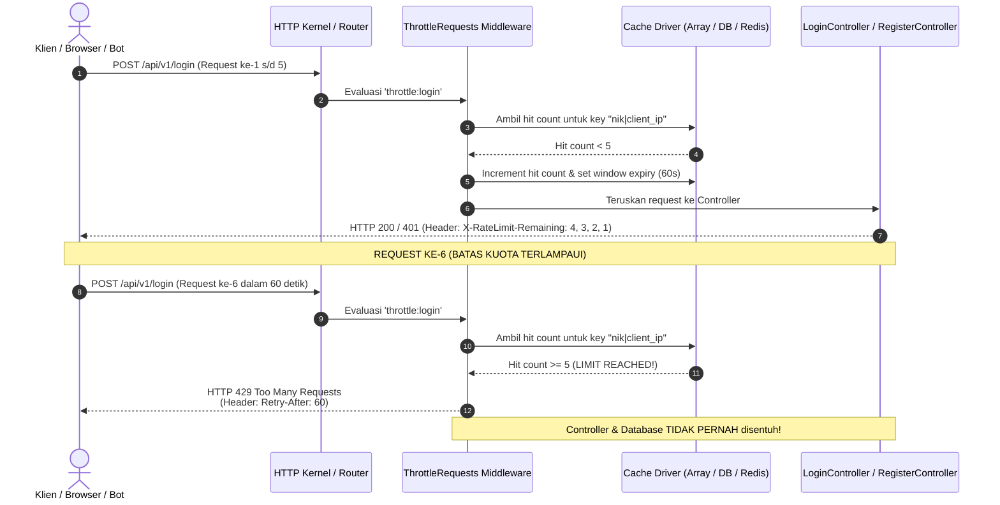

# Panduan Teknis Pembatasan Laju Permintaan (Rate Limiting & Throttling) — KLINIKU

Dokumen ini disusun khusus bagi DevOps / Infrastructure Engineer, Backend Developer, dan API Gateway Integrator untuk memahami arsitektur pembatasan laju request (**Rate Limiting / Throttling**) pada platform **KLINIKU**.

---

## 1. Ringkasan Eksekutif & Latar Belakang

Layanan API publik tanpa pembatasan laju request rentan terhadap eksploitasi yang diklasifikasikan dalam **OWASP API Security Top 10: Unrestricted Resource Consumption (API4:2023)**. 

### Ancaman yang Dimitigasi oleh Rate Limiting:
1. **Brute Force & Dictionary Attack pada Login**: Penyerang mengirimkan ribuan percobaan kombinasi kata sandi secara berulang.
2. **OTP Flooding / Email Spamming**: Penyerang memicu pengiriman email OTP terus-menerus yang dapat menghabiskan kuota harian SMTP Google Workspace serta membebani server email penerima.
3. **Application Layer Denial of Service (Layer 7 DoS)**: Penyerang membanjiri server dengan ribuan request per detik sehingga server kehabisan memori atau koneksi basis data.

Untuk mengatasi ancaman tersebut, KLINIKU menerapkan **Rate Limiting bertingkat (*Tiered Rate Limiting*)** menggunakan fasilitas bawaan Laravel 11 Cache Rate Limiter.

---

## 2. Arsitektur & Cara Kerja Rate Limiting

Rate Limiter bekerja sebagai **Middleware Interceptor** yang mengevaluasi request pada gerbang awal rute HTTP sebelum request tersebut sempat menyentuh *Controller* atau melakukan query ke basis data.



### Standar Header HTTP yang Dihasilkan:
Ketika rate limiting aktif, server secara otomatis menyertakan header standar RFC 6585 pada setiap respons:
- **`X-RateLimit-Limit`**: Jumlah maksimum request yang diperbolehkan dalam 1 periode window (misal: `5`).
- **`X-RateLimit-Remaining`**: Sisa kuota request yang masih dapat dilakukan pada window berjalan (misal: `4`, `3`, ..., `0`).
- **`Retry-After`**: Jumlah detik yang harus ditunggu oleh klien sebelum dapat melakukan request kembali (hanya muncul saat status `429`).

---

## 3. Rincian Batas Kuota Rate Limiting di KLINIKU

KLINIKU membagi rate limiting ke dalam 4 tingkatan spesifik:

| Nama Limiter | Batas Kuota | Periode | Kunci Identifikasi (*Signature Key*) | Target Rute API | Tujuan Keamanan |
| :--- | :--- | :--- | :--- | :--- | :--- |
| **`login`** | **5 kali** | 1 Menit (60s) | `NIK + IP Address` | `POST /api/v1/login`<br/>`POST /api/login` | Mencegah tebakan kata sandi & serangan *credential stuffing*. |
| **`otp`** | **5 kali** | 1 Menit (60s) | `otp_verify + IP Address` | `POST /api/v1/verify-otp`<br/>`POST /api/verify-otp` | Mencegah penebakan kode 6-digit OTP secara berulang. |
| **`otp_resend`**| **3 kali** | 1 Menit (60s) | `otp_resend + IP Address` | `POST /api/v1/resend-otp`<br/>`POST /api/resend-otp` | Mencegah eksploitasi pengiriman email massal (*email bomb*). |
| **`api`** | **60 kali** | 1 Menit (60s) | `User ID` atau `IP Address` | Seluruh rute di bawah `/api/v1/*` | Melindungi server dari spamming bot dan DoS. |

---

## 4. Berkas dan Potongan Kode Terkait

### 4.1 Registrasi Rate Limiter — [AppServiceProvider.php](file:///root/Melissa/kliniku/backend/app/Providers/AppServiceProvider.php)
Seluruh aturan pembatasan didefinisikan secara deklaratif di dalam method `boot()`:
```php
// File: backend/app/Providers/AppServiceProvider.php (Baris 23-64)

// 1. Global API Rate Limiter (60 requests per menit)
RateLimiter::for('api', function (Request $request) {
    $key = $request->user()?->user_id ?: $request->ip();
    return Limit::perMinute(60)->by($key)->response(function (Request $request, array $headers) {
        return response()->json([
            'success' => false,
            'message' => 'Terlalu banyak permintaan (Too Many Requests). Batas kuota request API terlampaui.',
        ], 429, $headers);
    });
});

// 2. Login Rate Limiter (5 percobaan per menit per NIK + IP)
RateLimiter::for('login', function (Request $request) {
    $nik = trim((string) $request->input('nik', ''));
    $key = Str::transliterate(Str::lower($nik)) . '|' . $request->ip();
    return Limit::perMinute(5)->by($key)->response(function (Request $request, array $headers) {
        return response()->json([
            'success' => false,
            'message' => 'Terlalu banyak percobaan login gagal. Demi keamanan, silakan tunggu 1 menit sebelum mencoba kembali.',
        ], 429, $headers);
    });
});

// 3. OTP Verification Rate Limiter (5 percobaan per menit per IP)
RateLimiter::for('otp', function (Request $request) {
    $key = 'otp_verify|' . $request->ip();
    return Limit::perMinute(5)->by($key)->response(function (Request $request, array $headers) {
        return response()->json([
            'success' => false,
            'message' => 'Terlalu banyak percobaan verifikasi kode OTP. Silakan tunggu 1 menit sebelum mencoba kembali.',
        ], 429, $headers);
    });
});

// 4. OTP Resend Rate Limiter (3 requests per menit per IP)
RateLimiter::for('otp_resend', function (Request $request) {
    $key = 'otp_resend|' . $request->ip();
    return Limit::perMinute(3)->by($key)->response(function (Request $request, array $headers) {
        return response()->json([
            'success' => false,
            'message' => 'Terlalu banyak permintaan kirim ulang kode OTP. Silakan tunggu 1 menit sebelum mencoba kembali.',
        ], 429, $headers);
    });
});
```

### 4.2 Penerapan Middleware pada Rute — [routes/api.php](file:///root/Melissa/kliniku/backend/routes/api.php)
Rate limiter dipasang pada grup endpoint sesuai dengan tingkat risiko:
```php
// File: backend/routes/api.php

Route::prefix('v1')->middleware('throttle:api')->group(function () {
    // Login terproteksi oleh throttle:login
    Route::middleware('throttle:login')->group(function () {
        Route::post('/login', [LoginController::class, 'login']);
    });

    // Verifikasi OTP terproteksi oleh throttle:otp
    Route::middleware('throttle:otp')->group(function () {
        Route::match(['get', 'post'], '/verify-otp', [LoginController::class, 'verifyOtp']);
    });

    // Kirim Ulang OTP terproteksi oleh throttle:otp_resend
    Route::middleware('throttle:otp_resend')->group(function () {
        Route::post('/resend-otp', [LoginController::class, 'resendOtp']);
    });
});
```

---

## 5. Format Respons Error Saat Batas Kuota Terlampaui

Ketika klien melampaui kuota, server mengembalikan status **HTTP 429 Too Many Requests**:

```http
HTTP/1.1 429 Too Many Requests
Content-Type: application/json
Retry-After: 60
X-RateLimit-Limit: 5
X-RateLimit-Remaining: 0

{
  "success": false,
  "message": "Terlalu banyak percobaan login gagal. Demi keamanan, silakan tunggu 1 menit sebelum mencoba kembali."
}
```

---

## 6. Pengujian Otomatis (Automated Testing)

Pengujian fitur rate limiting terdaftar pada [SecurityFeaturesTest.php](file:///root/Melissa/kliniku/backend/tests/Feature/SecurityFeaturesTest.php).

### Skenario Uji 1: Memverifikasi Percobaan Login ke-6 Diblokir dengan Status 429
```php
public function test_login_is_rate_limited_after_5_attempts(): void
{
    $nik = '3372020912254658';
    $ip = '127.0.0.1';
    $key = $nik . '|' . $ip;
    RateLimiter::clear($key);

    // Kirim 5 percobaan login gagal berturut-turut (HTTP 401)
    for ($i = 1; $i <= 5; $i++) {
        $response = $this->postJson('/api/v1/login', [
            'nik' => $nik,
            'password' => 'WrongPassword!',
            'recaptcha_token' => 'test-valid-token',
        ]);
        $response->assertStatus(401);
    }

    // Percobaan ke-6 WAJIB diblokir dengan HTTP 429 Too Many Requests
    $throttledResponse = $this->postJson('/api/v1/login', [
        'nik' => $nik,
        'password' => 'WrongPassword!',
        'recaptcha_token' => 'test-valid-token',
    ]);

    $throttledResponse->assertStatus(429);
    $throttledResponse->assertJson([
        'success' => false,
        'message' => 'Terlalu banyak percobaan login gagal. Demi keamanan, silakan tunggu 1 menit sebelum mencoba kembali.',
    ]);
    
    // Pastikan header Retry-After ada
    $this->assertTrue($throttledResponse->headers->has('Retry-After'));
}
```

### Skenario Uji 2: Memverifikasi Permintaan Kirim Ulang OTP ke-4 Diblokir
```php
public function test_otp_resend_is_rate_limited_after_3_attempts(): void
{
    $sessionId = 'resend_throttle_session_' . uniqid();
    RateLimiter::clear('otp_resend|127.0.0.1');

    $user = User::where('user_role', 'pasien')->first();
    Cache::put('email_otp_session_' . $sessionId, [
        'user_id' => $user->user_id,
        'user_nik' => $user->user_nik,
        'email' => $user->user_email,
        'otp_code' => '112233',
        'expires_at' => now()->addSeconds(300)->timestamp,
    ], 300);

    Mail::fake();

    // 3 kali kirim ulang diperbolehkan (HTTP 200)
    for ($i = 1; $i <= 3; $i++) {
        $response = $this->postJson('/api/v1/resend-otp', [
            'otp_session_id' => $sessionId,
        ]);
        $response->assertStatus(200);
        if (isset($response->json('data')['otp_session_id'])) {
            $sessionId = $response->json('data')['otp_session_id'];
        }
    }

    // Permintaan ke-4 WAJIB diblokir dengan HTTP 429
    $throttledResponse = $this->postJson('/api/v1/resend-otp', [
        'otp_session_id' => $sessionId,
    ]);

    $this->assertEquals(429, $throttledResponse->status());
    $throttledResponse->assertJson(['success' => false]);
}
```

---

## 7. Panduan untuk Pengembang Klien & Frontend

Ketika mengonsumsi API KLINIKU, frontend developer disarankan menangani kode status `429` secara elegan:

```javascript
async function requestWithRateLimitHandling(url, options) {
    const response = await fetch(url, options);

    if (response.status === 429) {
        // Ambil durasi tunggu dari header Retry-After (default 60 detik)
        const retryAfterSeconds = parseInt(response.headers.get('Retry-After') || '60', 10);
        const data = await response.json();

        // Tampilkan notifikasi ramah pengguna dengan countdown timer
        showWarningModal({
            title: 'Terlalu Banyak Permintaan',
            message: `${data.message} Silakan coba lagi dalam ${retryAfterSeconds} detik.`,
            lockDuration: retryAfterSeconds
        });

        return null;
    }

    return response;
}
```
